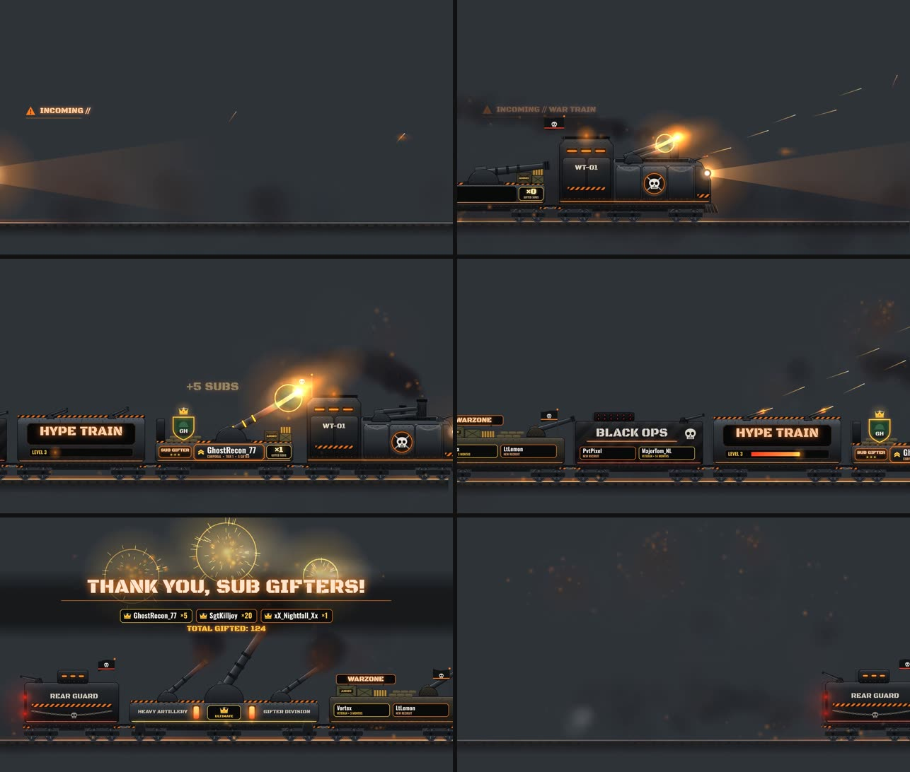

# WAR TRAIN: animated Twitch Hype Train overlay

A Call of Duty-inspired armored war train that rolls left to right across your stream. Every gifted
sub puts the gifter on their own **SUB GIFTER cannon wagon**: name plate, avatar shield, crown, rank
badge and gift counter, and the cannon fires a celebratory VFX blast. Everything is drawn
procedurally on a **truly transparent** HTML5 canvas, so there are no image assets to license or
replace.

- `index.html` is the OBS overlay (transparent, dynamic, reacts to Twitch events)
- `preview.html` is the same overlay with a control panel, transparency checker and mock events
- `dist/war-train-15s-alpha.webm` is a prerendered 15 s pass, VP9 with alpha. It's about 43 MB, so it isn't in git; generate it with `npm run render`



> Fan-made overlay, not affiliated with or endorsed by Activision. No game logos or assets are used.
> The wagon labels are plain text in `js/core/config.js`, so you can change them.

---

## Quick start

```bash
cd war-train
npm start              # = node server/server.mjs  → http://127.0.0.1:8787/preview.html
```

You can also open `preview.html` directly from disk (double-click), with no server needed.
Use the buttons in the panel to fire mock gifts, subs, resubs and hype-train events.

Requirements: any modern browser / OBS 28+. Node 18+ for the relay server, Node 22+ for Twitch
EventSub. The render/test tools also need Playwright and ffmpeg.

## The six scenes (15 s)

| # | Time | What happens |
|---|------|--------------|
| 1 | 0–2 s | Rails fade in, smoke banks, distant muzzle flashes, headlight glare breaks through the smoke, `INCOMING // WAR TRAIN` HUD |
| 2 | 2–4 s | Armored locomotive: twin turret fires twice (recoil, flash, blast), front MG fires tracer bursts, steam release, stack smoke, beacon, skull flag |
| 3 | 4–7 s | **SUB GIFTER cannon wagon**: name plate slams in, avatar shield, crown drops, cannon aims, charges (energy converges), fires, recoils, screen shake, counter rolls up, `+N SUBS` |
| 4 | 7–10 s | HYPE TRAIN (level and progress bar, twin MGs), BLACK OPS (rocket pod and new-sub plates), WARZONE (gondola, cannon, resub plates) pass at speed |
| 5 | 10–13 s | Heavy artillery wagon: 3 synchronized volleys bursting in the sky, `THANK YOU, SUB GIFTERS!`, recent gifter roster with crowns, animated total counter |
| 6 | 13–15 s | Rear guard caboose exits right, red tail lights fade into smoke, rails and embers fade to fully transparent, ready to replay |

When several gifters ride in one pass (up to `maxGiftersPerRun`, default 3), each extra wagon adds
`extraGifterSeconds` (2.2 s) to scene 3. Anyone beyond that rides the next pass.

## Folder structure

```
war-train/
├─ index.html              OBS overlay
├─ preview.html            preview + control panel
├─ css/overlay.css         transparent page, local fonts
├─ css/preview.css         preview panel only
├─ js/core/util.js         math, easing, monotone motion spline, canvas helpers
├─ js/core/config.js       ALL settings + URL overrides
├─ js/core/sound.js        sound hooks (muted by default) + placeholder synth
├─ js/fx/particles.js      smoke, steam, sparks, embers, tracers, flashes, blasts, shockwaves, shake
├─ js/train/parts.js       procedural drawing kit (armor, rivets, wheels, cannons, skulls, crowns…)
├─ js/train/wagons.js      Locomotive, GifterCannonWagon, ThemedWagon, ArtilleryWagon, Caboose
├─ js/show/run.js          one train pass: composition, motion curve, the six scenes, HUD
├─ js/events/controller.js normalise → dedupe → merge → queue → schedule passes, stats
├─ js/events/adapters.js   StreamElements, SSE relay, mock events
├─ js/main.js              boot, render loop, window.WarTrain API
├─ js/preview-panel.js     preview UI
├─ server/server.mjs       local relay: static files + SSE + POST /api/emit (+ EventSub)
├─ server/eventsub.mjs     Twitch EventSub WebSocket client (server-side tokens)
├─ server/.env.example     credentials template (copy to server/.env, never commit)
├─ tools/build.cjs         single-file bundle + StreamElements widget files
├─ tools/render-webm.cjs   prerender transparent WebM (+ MP4 preview)
├─ tools/snapshots.cjs     render key frames + transparency report
├─ tools/test-integrations.cjs  automated SE / relay / queue checks
├─ assets/fonts/           Black Ops One + Oswald (SIL Open Font License)
└─ dist/                   build output (bundle, SE widget, WebM)
```

## Add to OBS

**Dynamic overlay (recommended, reacts to real events):**
1. Sources → **+** → **Browser**.
2. Either tick **Local file** and pick `war-train/index.html`, or use the URL
   `http://127.0.0.1:8787/index.html?sse=http://127.0.0.1:8787/events` when running the relay.
3. Width **1920**, height **1080**. Leave *Custom CSS* empty (or keep OBS's default
   `body { background-color: rgba(0,0,0,0); }`).
4. Tick **Shutdown source when not visible** only if you don't need the queue to survive scene switches.
5. For audio, add `?sound=1` and tick **Control audio via OBS**. Sound is off by default.

The overlay is fully transparent while idle and only draws when a train passes.

**Prerendered video (no dynamic names):** add a *Media Source* with
`dist/war-train-15s-alpha.webm`. OBS reads VP9 alpha natively. Trigger it with a hotkey or
alert, or loop it.

### URL parameters

| Param | Values | Default |
|---|---|---|
| `mode` | `events` (run on events) / `loop` (replay demo forever) | `events` (`loop` in preview) |
| `source` | `auto` / `mock` (random events) / `streamelements` / `none` | `auto` |
| `sse` | relay URL, e.g. `http://127.0.0.1:8787/events` | off |
| `sound` | `1` to enable | off |
| `volume` | `0`–`1` | `0.5` |
| `quality` | `high` / `low` | `high` |
| `maxGifters` | gifter wagons per pass | `3` |
| `avatars` | `decapi` to look up avatars by username (public service, no token) | off |
| `persist` | `0` to not remember totals/recent gifters | on |

## Twitch integration

All sources feed one normalised event shape into `controller.handle()`:

```js
{ type: 'gift' | 'sub' | 'resub' | 'hypetrain_levelup' | 'hypetrain_progress' | 'hypetrain_end',
  id, username, avatarUrl, count, tier, months, level, progress, goal }
```

Gift flow: receive → dedupe by `id` → merge repeat gifts from the same user (within 1.8 s, while
still queued) → queue → after a 1.2 s grace period (so bulk gifts can arrive) a pass starts with up
to 3 gifter wagons → each cannon fire adds the gifts to the total and the roster. Events that arrive
mid-pass wait for the next pass and never interrupt the current one.

### Option A: StreamElements custom widget (simplest, no server)
1. `node tools/build.cjs`
2. StreamElements → Overlays → new 1920×1080 overlay → **+** → Static/Custom → **Custom widget** → Open editor.
3. Paste `dist/streamelements/widget.html`, `widget.css`, `widget.js` and `fields.json` into the HTML / CSS / JS / FIELDS tabs. Save.
4. Use SE's **Emulate** → Subscriber / Gifted / Community gift to test. Add the SE overlay URL to OBS as a Browser source.

Mapping: SE community gifts (`bulkGifted`) count once for the gifter. The per-recipient events
(`isCommunityGift`) are ignored so nothing is counted twice.

### Option B: own relay + Twitch EventSub (server-side tokens)
1. `cp server/.env.example server/.env` and fill in `TWITCH_CLIENT_ID`, `TWITCH_USER_TOKEN`
   (broadcaster user token with `channel:read:subscriptions` and `channel:read:hype_train`) and `TWITCH_BROADCASTER_LOGIN`.
2. `npm start` (Node 22+). The relay subscribes to `channel.subscribe`, `channel.subscription.message`,
   `channel.subscription.gift` and `channel.hype_train.begin/progress/end`, looks up gifter avatars,
   and pushes normalised events over SSE.
3. In OBS use `http://127.0.0.1:8787/index.html?sse=http://127.0.0.1:8787/events`.

Test without Twitch:
```bash
curl -X POST http://127.0.0.1:8787/api/emit -H 'content-type: application/json' \
     -d '{"type":"gift","username":"SgtKilljoy","count":10,"tier":"1000"}'
```
(`/api/emit` only accepts localhost and, if `EMIT_KEY` is set, requires the `x-emit-key` header.)

### Option C: Streamlabs
Streamlabs has no custom-widget event hook like StreamElements. Its Socket API token is a secret,
so it must not go in the overlay. Use Option B (EventSub works regardless of your alert provider),
or add a Streamlabs socket client to `server/server.mjs` that calls `broadcast()` with the normalised
shape above. That client is **not implemented**.

### Option D: your own code / Streamer.bot / Node-RED
Call `window.WarTrain.handle({...})` from any script on the page, or POST to `/api/emit`.

## Customisation

- **Texts, colours, timing, queue limits, demo names:** `js/core/config.js`, or set
  `window.WAR_TRAIN_CONFIG = {...}` before `main.js` loads.
- **Wagon designs:** `js/train/wagons.js`. Each wagon paints static armor once into a cached sprite
  (`paint()`) and animates moving parts in `drawLive()`.
- **Scene timing / choreography:** `js/show/run.js` → `buildCues()` and the motion keyframes `K`.
- **Sounds:** put files in `assets/sfx/` and set `sound.files.{rumble,whistle,clank,cannon,reload,steam,sting}`.
  Hooks without a file use the built-in placeholder synth.
- **GifterCannonWagon** takes `{ username, avatarUrl, giftCount, tier, eventId }`. Rank badge by
  gift count: 1–4 private (1 chevron), 5–9 corporal, 10–19 sergeant, 20–49 colonel (star), 50+ general (crown).

## Render the transparent WebM

```bash
NODE_PATH=$(npm root -g) node tools/render-webm.cjs dist 60
```
This steps the deterministic simulation frame by frame in headless Chromium, exports PNGs with
alpha, and encodes `war-train-15s-alpha.webm` (VP9, `yuva420p`) plus `war-train-15s-preview.mp4`
(H.264 on a dark background, for quick viewing).

## What works and what is placeholder

| Feature | Status |
|---|---|
| 15 s animation, 6 scenes, 60 fps canvas, transparent background | **Works**. Verified: corners and idle state have alpha 0, ~1.7 ms per frame in headless Chromium |
| GifterCannonWagon (plate, avatar slot, crown, rank, counter, cannon routine), multiple wagons, no overlapping names (text auto-fits) | **Works** |
| Queue, merge, dedupe, no interruption, multi-pass | **Works** (automated test) |
| Mock events + preview panel | **Works** |
| StreamElements widget mapping (sub, resub, gift, community gift) | **Works with simulated SE payloads** (automated test). Not yet tried in a live SE account |
| SE hype-train listener mapping | Best effort. SE listener names for hype train vary |
| Local relay (SSE + `/api/emit`) | **Works** (automated test) |
| Twitch EventSub client (`server/eventsub.mjs`) | **Implemented, not tested against live Twitch** (no credentials in this environment) |
| Streamlabs | **Not implemented** (see Option C) |
| Avatars | Work with any CORS-enabled image URL. Default is a placeholder helmet with initials. EventSub relay supplies real avatars (untested); `?avatars=decapi` uses a public lookup |
| Sound | Hooks work. Sounds are **placeholder WebAudio synth**, so replace them with real SFX files |
| Art | 100% procedural canvas drawing. No image assets needed; no external placeholders |
| Prerendered WebM with alpha | **Works**. Verified: decoded frames contain real alpha (≈29% fully transparent pixels in scene 5) |

## Fonts
Black Ops One and Oswald are bundled from Google Fonts under the SIL Open Font License 1.1.
